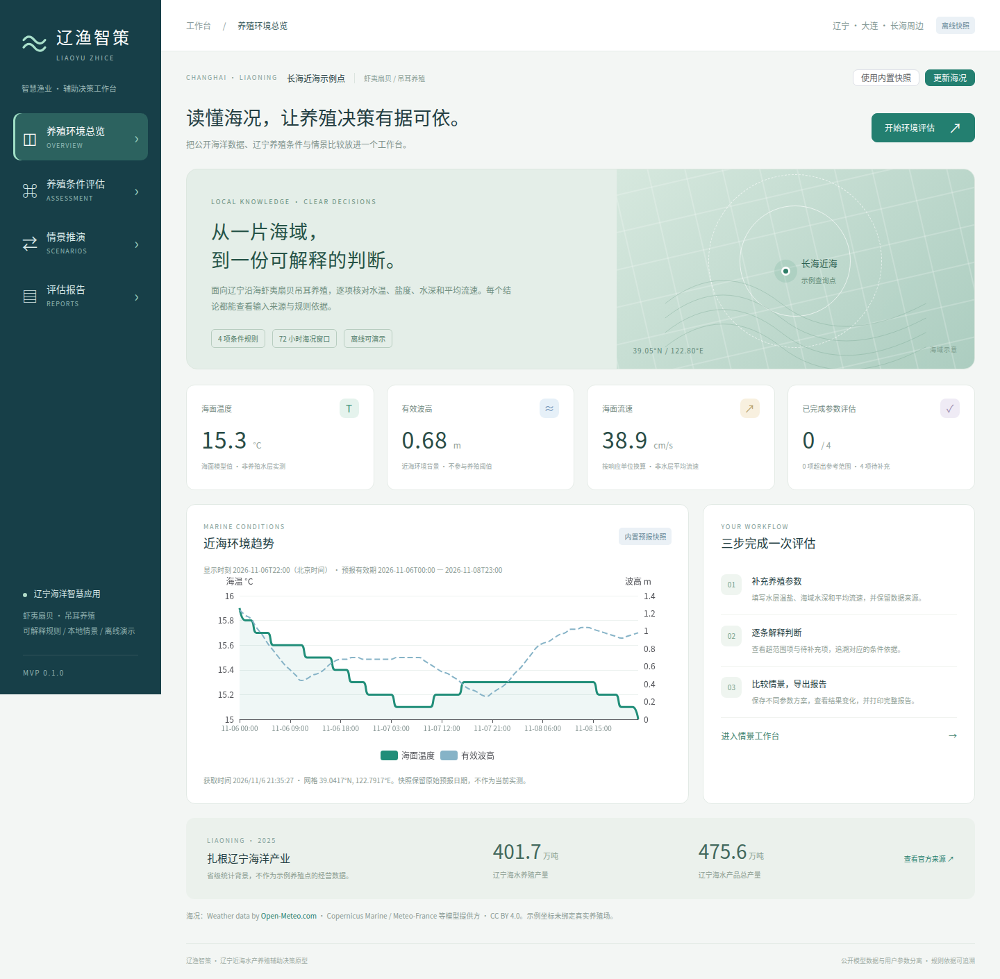

# 辽渔智策 · Liaoyu Zhice

辽宁近海水产养殖环境评估与生产辅助决策平台，首期聚焦大连长海周边虾夷扇贝吊耳养殖。

这是一个无需账户、数据库、GPU或硬件的纯前端竞赛 MVP。公开海况、用户填写参数、模拟情景各自标注来源；规则判断、情景比较和报告均可在本机断开外网时使用。

## 验收与预览

已完成 50 项单元测试、6 项生产构建浏览器流程测试及真实快照校验。详见 [验收记录](docs/acceptance.md)。源码、已编译站点和验收证据见本仓库的 [Releases](https://github.com/hikjesen/liaoyu-zhice/releases)。仓库保持私人。



## 运行

开发环境：Node.js 22.19.0、pnpm 10.20.0（版本写入 package.json 与 CI）。

```sh
corepack enable
corepack prepare pnpm@10.20.0 --activate
pnpm install --frozen-lockfile
pnpm dev
```

浏览器打开命令行显示的本机地址。`pnpm build` 生成 `dist/`；`pnpm preview --port 4173` 预览生产版本。已编译包不需要安装 npm 依赖，可以用 `node scripts/serve.mjs dist`，或 Python 3.8+ 的 `python scripts/serve.py dist` 启动。

## 已实现的业务范围

- **养殖环境总览**：长海近海示例点、72小时真实模型海温/浪高/流速趋势、辽宁2025年海洋渔业统计背景、数据日期和网格坐标。
- **养殖条件评估**：DB21/T 3719—2023 第4.1/4.2条的水温、盐度、水深、海水平均流速四项参考检查；边界包含、空值、无效值、模型参考值分别处理。
- **情景推演**：基准/高温/低盐模拟参数、即时结果反馈、最多五个本地情景、载入/删除/对比和浏览器持久保存。
- **评估报告**：参数及来源、逐项判断、复核事项、情景对比、规则版本及资料出处；JSON导出/参数重新导入、打印版排版。
- **离线与故障处理**：默认读取仓库内真实预报快照，按需更新在线海况；网络失败保留已有数据，显示明确状态。应用启动不访问外部CDN或字体。

## 结构

```text
src/views/          四个业务页面
src/engine/         纯TypeScript规则、类型、输入校验与判断
src/services/       海况适配、单位换算、报告生成
src/stores/         本地工作区、情景持久化、离线回退
src/data/           示例点、行业统计、来源清单、真实海况快照
src/components/     图表、参数输入、规则表及模板响应式组件
scripts/            获取/校验数据、分发声明、本地静态服务
 tests/             规则、数据适配、报告单元测试
 e2e/               生产构建的浏览器流程验收
 docs/              模型、来源、使用、演示、验收与版权记录
```

## 数据与模型边界

示例查询坐标为39.05°N、122.8°E，未绑定真实养殖场。Open-Meteo返回的是数值模型预报；快照保留获取时刻、预报时段、请求URL、返回网格与原始单位。海面模型温度和瞬时流速不自动作为养殖水层实测/海水平均流速参与规则通过判定。

四项条件分别判定，不使用任意加权“安全总分”。可判定覆盖率 =（范围内项数 + 超范围项数）/ 4；它不代表安全率或存活率。条件全部在范围内也只表示这四项参考比较通过。生产部署需要核对标准的其他引用要求、当地条件与实际观测。

地方标准的正式文本已通过国家市场监管总局国家标准技术审评中心公开入口获取；规则保存条款、页码和原文件SHA-256。完整标准PDF不随项目分发。

## 质量检查

```sh
pnpm verify:data
pnpm typecheck
pnpm test
pnpm build
pnpm exec playwright install chromium
pnpm test:e2e
```

CI对生产构建运行浏览器流程，覆盖离线页面、参数判断、情景持久化、JSON导出、网络失败回退及390px移动端。请以 Actions 运行结果和 [验收记录](docs/acceptance.md) 为实际状态，不以测试脚本存在作为通过依据。

## 开源复用与原创模块

仓库从 `pure-admin/pure-admin-thin` 的模板创建，上游记录为 `f0ff132561ab684bb78379239adf29f9a38ac7f1`。为纯前端小型原型裁剪了登录、权限、Mock接口及与场景无关的管理模块；保留MIT许可和适配后的 ReCol 响应式组件，沿用 Vue / Element Plus / ECharts 技术组合。

本项目新增：规则结构与求值器、来源管理、海况适配、输入来源隔离、情景比较、报告、四个业务页面、离线数据和自动化验收。项目在用户授权下由编程Agent辅助实现，参赛团队应自行复核、理解并按比赛要求说明贡献。

详见 [使用说明](docs/quick-start.md)、[决策模型](docs/decision-model.md)、[数据来源](docs/data-sources.md)、[演示流程](docs/demo-guide.md)、[第三方声明](docs/third-party-notices.md)。
